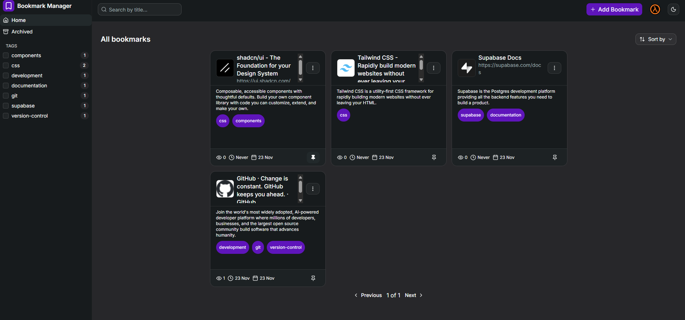

# bookmark-manager-app

This is a full-stack web application that allows you to manage bookmarks containing a URL, title, and description. It was inspired by this [challenge](https://www.frontendmentor.io/challenges/bookmark-manager-app) by Frontend Mentor.

You can try it [here](https://bookmark-manager-app-two.vercel.app/).



## Features

- **Dark Mode**: Users can toggle between a dark mode and a light mode
- **Sorting/Filtering**: Users can sort bookmarks by recently added, recently visited, or most visited
- **Pagination**: Users can even bookmark their own pages of bookmarks

## Core Technologies

- **Front End**: Next.js, Tailwind CSS, shadcn/ui
- **Back End**: Supabase, Server Actions

## Installation

### Prerequisites

In order to run this project locally, you must have the following installed/set up:

- [Node.js](https://nodejs.org/en)
- pnpm (`npm install -g pnpm`)
- [Docker Desktop Installation](https://docs.docker.com/desktop) (Necessary for using Supbase CLI)

### Instructions

1. Clone the repository

```bash
git clone https://github.com/tmatth11/bookmark-manager-app.git
```

2. Navigate to the project's directory

```bash
cd bookmark-manager-app
```

3. Install dependencies

```bash
pnpm install
```

4. Open Docker Desktop
5. Start Supabase services

```bash
pnpm supabase start
```

6. Apply existing migrations

```bash
pnpm supabase db reset
```

7. Create local `.env.local` file
8. Add this template to the `.env.local` file and insert the necessary values

```
NEXT_PUBLIC_SUPABASE_URL=
NEXT_PUBLIC_SUPABASE_PUBLISHABLE_KEY=
```

9. Start the development server

```bash
pnpm dev
```
